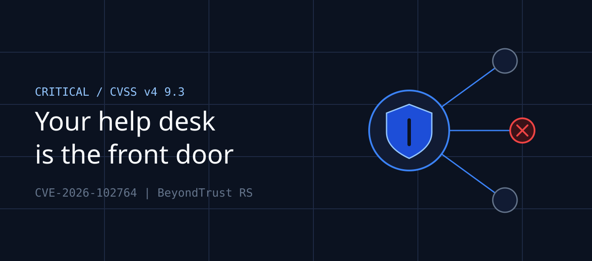

*Disclaimer: This featured image was generated using AI tools incorporating the Vibhank Associates brand assets.*

It's 2:47 a.m. and nobody on your security team is awake. Your IT service desk has just opened a remote support session to a finance workstation. The session looks routine, the technician account is legitimate, and your EDR logs it as sanctioned administrative activity.

Except no technician started it. An attacker did, from inside the very tool you bought to make support safer.

This is the brutal reality of **privileged remote access** flaws. The attacker doesn't have to break in and then hunt for credentials. They compromise the system that already holds the keys to everything. Mandiant observed the threat actor, after gaining elevated administrative privileges, using the appliance to establish remote support sessions to internal endpoints. That is what happened with **CVE-2026-102764**, and your patch window is already shorter than you think.

> ## Key Takeaways
> - **The flaw:** CVE-2026-102764 is a critical authentication bypass in BeyondTrust Remote Support. BeyondTrust says it has been exploited as a zero-day since late August.
> - **The exposure:** Self-hosted appliances on version 26.2.3 or earlier are affected and must be patched manually unless auto-updates are enabled.
> - **The urgency:** CISA added it to the KEV catalog on October 16, 2026, and Mandiant has documented post-exploitation persistence and lateral movement.
> - **The lesson:** Treat remote access tooling as Tier 0 infrastructure, with the same rigor you apply to your identity provider.

## What Actually Happened

The Canadian Cyber Centre classifies CVE-2026-102764 as an Authentication Bypass by Spoofing (CWE-290). A remote, unauthenticated attacker can exploit insufficient origin validation in internal messaging components to perform unauthorized file operations on the appliance, with no user interaction. In plain terms, the appliance trusts messages it should not trust.

BeyondTrust's advisory BT26-05 rates it CVSS v4 9.3 (Critical) and was issued October 15, 2026. The vendor patched its SaaS customers around October 8–9, but that is only part of the story. If you run Remote Support on your own infrastructure, you own the patch.

The timeline is the uncomfortable part. Exploitation reportedly began in late August. Disclosure came on October 15, and the KEV listing followed on October 16. That leaves roughly **seven weeks** during which an attacker could have been inside your appliance while your vulnerability scanner found nothing, because no CVE existed yet.

## Why Remote Support Appliances Are Such a Prize

A remote support platform is one of the few systems built to do what attackers want. It reaches into endpoints and runs with elevated rights. It also holds session history and often sits on the internet edge, so a technician can connect from anywhere.

Compromise the appliance and you inherit its reach. CISA reports that threat actors are using the flaw for initial access, then establishing persistence, escalating privileges, and moving laterally. That is the full intrusion chain from a single internet-facing box.

This also isn't BeyondTrust's first appearance in the headlines. Attackers recently exploited another critical RCE flaw, CVE-2026-1731, in Remote Support and Privileged Remote Access appliances to deploy ransomware. The Silk Typhoon group is also believed to have exploited earlier zero-days to compromise 17 Remote Support SaaS instances. The pattern is clear: this product category is being hunted systematically.

### The Hard Part: Finding Evidence

Mandiant found evidence of exploitation in the access, syslog, messages, and other log files, which sit on a LUKS-encrypted partition under the /home directory. That matters operationally. Your standard log shipping may never collect these files, so "we saw nothing in the SIEM" is not proof of a clean system.

## A Failure Analysis: How a Mid-Size Company Gets Burned

Here is an illustrative composite scenario, not a specific client, built from the attack pattern documented by CISA and Mandiant.

A 900-person healthcare services company runs a self-hosted remote support appliance. It was installed three years ago and has been upgraded twice, but automatic updates were disabled after a bad patch broke an integration. The appliance sits in a DMZ with a public IP so remote contractors can connect.

The weaknesses stack up quickly:

- **Stale versions.** The appliance runs a pre-patch build, and nobody owns the advisory feed.
- **Unmonitored logs.** The appliance's local logs never reach the SIEM.
- **Flat network trust.** The appliance can open sessions to nearly any internal endpoint.
- **Standing privilege.** Support sessions inherit local admin rights, with no just-in-time elevation.

An attacker uses the bypass to gain administrative control and establishes persistence. They then use the platform's own session capability to reach a file server holding patient data. No malware is dropped at first, because the support tool does the work. By the time ransomware appears, the intrusion is weeks old.

The root cause wasn't one missed patch. It was **treating a privileged access tool like a convenience utility**.

## Mapping the Risk to Your Compliance Frameworks

A vulnerability like this lands in an auditor's inbox fast, so it is worth knowing which controls it touches.

| Framework | Control Area | Why It's Implicated |
|---|---|---|
| **SOC 2** | CC6.1 / CC6.6 (logical access, boundary protection) | An internet-facing privileged tool with a bypass undermines access controls |
| **SOC 2** | CC7.1 / CC7.2 (vulnerability and anomaly detection) | You must show you detect and respond to new threats |
| **ISO 27001:2022** | A.8.8 (technical vulnerability management) | Requires timely evaluation and remediation of known flaws |
| **ISO 27001:2022** | A.8.15 / A.8.16 (logging, monitoring) | Appliance logs must be captured and reviewed |
| **ISO 27001:2022** | A.5.19–A.5.21 (supplier relationships) | A vendor flaw is your risk to manage |
| **HIPAA Security Rule** | §164.308(a)(1) risk analysis; §164.312(a)/(b) access and audit controls | Unauthorized access to systems touching ePHI is a reportable-breach risk |
| **PCI DSS 4.0** | Requirement 6.3.3 (patching) | Critical patches are expected within one month of release |

> **Audit reality:** "The vendor was slow" is not a defense. Auditors ask when you learned of the vulnerability and what you did next. Keep timestamps.

## What to Do Right Now

You can break the response into three phases and work through them in order.

### Phase 1: Find and Patch

Inventory every Remote Support deployment and determine whether each is SaaS or self-hosted. Systems on 26.2.3 or earlier are affected. Apply the BT26-05-RS patch to versions 24.3.1 through 26.2.3, and upgrade anything older than 24.3.1 before applying it. If your patch cycle is monthly, this is the week to break it.

### Phase 2: Hunt, Don't Assume

Patching closes the door but doesn't evict someone already inside. Review the appliance's local logs, especially the encrypted partition Mandiant described, and follow the hunting guidance in Mandiant's ARMORY CASTLE write-up. Audit recent support sessions for any you can't tie to a ticket and a named technician.

### Phase 3: Reduce the Blast Radius

Place the appliance in a restricted segment with explicit allow-lists for outbound sessions. Require just-in-time privilege elevation instead of standing admin. Forward its logs off-box so a compromised appliance can't erase its own history.

## Rethinking Privileged Access as Tier 0

The deeper lesson isn't about one vendor. Any tool that can reach every endpoint with elevated rights belongs in your highest-trust tier. That includes remote support platforms, RMM agents, PAM vaults, and backup consoles.

Ask your team four uncomfortable questions. Who owns the patch SLA for each of these tools? Are they internet-exposed, and do they truly need to be? Does their telemetry flow to your SIEM? And could you disable them within the hour if one were compromised?

If the answer to any of those is "I'm not sure," you have found your next remediation project.

## Conclusion & Action Plan

CVE-2026-102764 is a reminder that attackers go after the tools that grant access. Your remote support platform deserves the same scrutiny as your domain controllers.

Do these three things **today**:

1. **Identify and patch.** Inventory every BeyondTrust Remote Support instance, confirm the version, and apply the BT26-05-RS patch to self-hosted deployments immediately.
2. **Hunt for compromise.** Review appliance logs and recent support sessions for unexplained activity going back to late August, and escalate anything suspicious to incident response.
3. **Contain the blast radius.** Restrict the appliance's network reach, enforce just-in-time elevation, and ship its logs to your SIEM.

Need help assessing exposure across your privileged access stack or mapping this incident to your audit evidence? The Vibhank Associates team can help.

## References

1. CISA, "CISA Urges Patching Critical Vulnerability in BeyondTrust Remote Support" (Oct 16, 2026): https://www.cisa.gov/news-events/alerts/2026/10/16/cisa-urges-patching-critical-vulnerability-beyondtrust-remote-support
2. BeyondTrust Security Advisory BT26-05: https://www.beyondtrust.com/trust-center/security-advisories/bt26-05
3. Canadian Centre for Cyber Security, Alert AL26-025: https://cyber.gc.ca/en/alerts-advisories/al26-025-critical-vulnerability-impacting-beyondtrust-remote-support-cve-2026-102764
4. BleepingComputer, "BeyondTrust patches zero-day exploited in attacks since August" (Oct 16, 2026): https://bleepingcomputer.com/news/security/beyondtrust-patches-zero-day-exploited-in-attacks-since-august
5. Google Threat Intelligence / Mandiant, "ARMORY CASTLE Exploits BeyondTrust" (original URL to be added before publishing)
