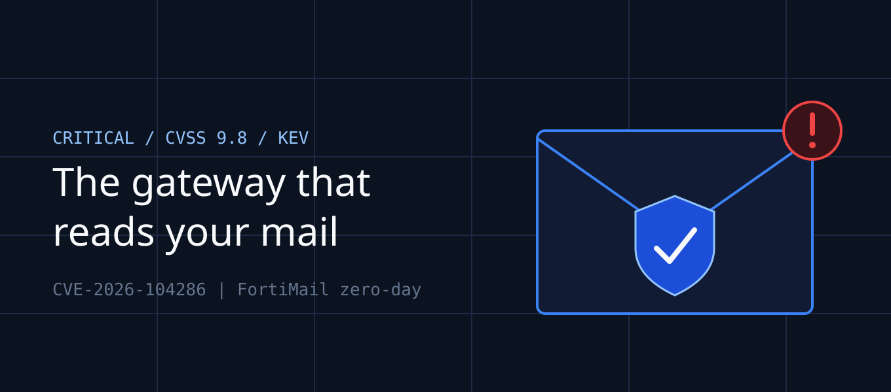

*Disclaimer: This featured image was generated using AI tools incorporating the Vibhank Associates brand assets.*

Your finance lead forwards an invoice to accounts payable. It arrives on time, looks normal, and the bank details have changed by one account number. Nobody notices, because every control you bought to stop this sits in front of the mailbox and says the message is clean.

The problem is the box doing the scanning. If an attacker owns your email security gateway, they don't need to phish anyone. They read the mail, copy it, and rewrite it on the way through. That is the scenario behind **CVE-2026-104286**, a FortiMail zero-day that moved from "patch when convenient" to incident response on October 1.

> ## Key Takeaways
> - **The flaw:** CVE-2026-104286 is a CVSS 9.8 path traversal in FortiMail that lets an unauthenticated attacker write arbitrary files through crafted web requests.
> - **The status:** It was exploited as a zero-day, added to CISA's KEV catalog on October 1, and flagged for forensic triage under BOD 26-04.
> - **The trap:** Patching closes the door but does not tell you whether someone is already inside.
> - **The shift:** Perimeter appliances are now a favorite first step. Treat them as high-value assets, not background plumbing.

## What Actually Happened

On October 1, Fortinet warned that a path traversal vulnerability in FortiMail was being exploited in the wild. Its advisory, FG-IR-26-175, says an unauthenticated attacker can write arbitrary files onto the underlying system through crafted web requests. The flaw combines path traversal (CWE-22) with improper handling of NULL characters (CWE-158).

CISA added it to the Known Exploited Vulnerabilities catalog the same day. Federal agencies were given until October 4, a three-day window, and CISA marked the issue as requiring forensic triage under BOD 26-04. For Fortinet versions without a fix at the time, the vendor urged customers to apply workarounds until patches arrived.

You should read the exact version guidance in the advisory itself rather than rely on any summary, including this one. Fix availability differs by version.

## Why an Email Gateway Is Such a Good Target

A mail security gateway sits at a rare intersection. It handles all inbound mail and often holds the keys to decrypt, inspect and reroute traffic. It is also commonly internet-facing, since that is where mail arrives.

Compromise it and you gain a persistent foothold on a trusted appliance. One security consultant quoted in coverage of the flaw pointed to the likely ability to redirect or blind-copy inbound email for business email compromise. That turns an infrastructure bug into a fraud engine.

This is not an isolated case. CISA's October 16 additions included another Fortinet path traversal, CVE-2025-61624, alongside the BeyondTrust remote support flaw. Reporting around the FortiMail zero-day also noted in-the-wild exploitation of NetScaler Gateway issues. The pattern is steady: edge appliances keep landing in the exploited-vulnerabilities list.

## The Indicators You Should Hunt For

Fortinet published indicators of compromise, and the list is worth reading closely. It includes added files at `/data/lib/liblog.so`, `/data/bin/webconsole` and `/data/bin/mailservice`, plus changes to `/data/etc/ld.so.preload`.

The `ld.so.preload` entry matters most. It is a Linux mechanism that loads a library into every process on the system, so an attacker who edits it can run their code inside everything, including the mail service. The indicators also point to a modified web server configuration.

Check these on every FortiMail you run, even if it is already patched. Absence of indicators is reassuring, but only if you verified the system rather than assumed it.

## A Failure Analysis: Patched, But Not Clean

Here is an illustrative composite scenario, not a specific client. A 600-person services firm runs an on-premises FortiMail with its management interface reachable from the internet, for the convenience of a remote admin.

The attacker writes a malicious library through the flaw and loads it through the preload file. Inbound invoices are silently copied to an external mailbox. Eight days later the firm applies the fix and marks the ticket closed.

Three weeks after that, a supplier calls to ask why a payment arrived in the wrong account. The patch worked. The attacker was already persistent, and nobody had looked.

The root cause was treating a patch as an eviction. BOD 26-04 makes the same point: it sets expectations for checking whether a system was compromised before the patch was applied.

## Mapping the Risk to Your Compliance Frameworks

An exploited mail gateway reaches well beyond IT. It touches the controls your auditors and regulators care about.

| Framework | Control Area | Why It's Implicated |
|---|---|---|
| **SOC 2** | CC6.6, CC7.2, CC7.3 | Boundary protection, anomaly detection and incident evaluation |
| **ISO 27001:2022** | A.8.8 technical vulnerability management | Timely remediation of known flaws |
| **ISO 27001:2022** | A.5.24–A.5.26 incident management | Planning, assessing and responding to events |
| **HIPAA Security Rule** | §164.308(a)(6) security incident procedures | Email often carries ePHI |
| **GDPR** | Articles 32 and 33 | Security of processing and 72-hour breach notification |

> **Audit reality:** if mail was copied and you can't prove otherwise, you may have to assume a notifiable breach. The clock starts when you become aware, not when you finish investigating.

## What to Do Right Now

Work through three steps in order, and don't skip the middle one.

### Step 1: Find and Contain

List every FortiMail instance and check whether its management and web interfaces are exposed to the internet. Apply the fix or Fortinet's workaround for your version, and restrict administrative access to a management network.

### Step 2: Hunt Before You Trust

Check each appliance for the published indicators, especially the preload entry and the added binaries. Review mail rules and routing for unexplained copies or redirects. If anything matches, treat it as an incident and preserve evidence before rebuilding.

### Step 3: Reduce Your Appliance Risk

Keep a register of every internet-facing security appliance with an owner and a patch deadline. Forward their logs to your SIEM, since a compromised box can't be trusted to report on itself. Add out-of-band checks for payment-detail changes, so a rewritten invoice fails a process control even if the email control fails.

## Conclusion & Action Plan

CVE-2026-104286 shows how a tool meant to protect your mail can become the way it is stolen. Patching is the start of the job, not the end.

Do these three things **today**:

1. **Inventory and patch.** Find every FortiMail, confirm exposure, and apply the fix or workaround for your version from advisory FG-IR-26-175.
2. **Hunt for compromise.** Check for the published indicators and review mail routing rules before you declare any system clean.
3. **Add a payment safeguard.** Require a call-back to a known number before any change to supplier bank details is accepted.

Need help assessing your edge appliances or building an evidence trail for your auditors? The Vibhank Associates team can help.

## References

1. CISA, "CISA Adds One Known Exploited Vulnerability to Catalog" (Oct 1, 2026): https://www.cisa.gov/news-events/alerts/2026/10/01/cisa-adds-one-known-exploited-vulnerability-catalog
2. Fortinet PSIRT, advisory FG-IR-26-175: https://fortiguard.fortinet.com/psirt/FG-IR-26-175
3. The Hacker News, "Critical FortiMail Zero-Day Flaw Exploited in Attacks" (Oct 2, 2026): https://thehackernews.com/2026/10/critical-fortimail-zero-day-flaw.html
4. SC Media, "Fortinet FortiMail bug exploited in the wild, added to CISA KEV list" (Oct 2, 2026): https://www.scworld.com/news/fortinet-fortimail-bug-exploited-in-the-wild-added-to-cisa-kev-list
5. CISA, "CISA Adds Two Known Exploited Vulnerabilities to Catalog" (Oct 16, 2026): https://www.cisa.gov/news-events/alerts/2026/10/16/cisa-adds-two-known-exploited-vulnerabilities-catalog
