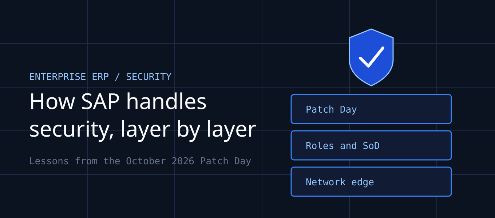

*Disclaimer: This featured image was generated using AI tools incorporating the Vibhank Associates brand assets.*

It's the second Tuesday of the month, and your SAP Basis team is staring at a fresh list of security notes. The one scored 9.9 touches the module your finance team closes the books in. Patching means a change window, regression testing, and a conversation nobody wants to have.

Not patching means an ordinary user may be one crafted request away from controlling the system. This is the tension every SAP security owner lives with. Understanding how SAP itself handles security tells you where its responsibility ends and yours begins.

> ## Key Takeaways
> - **SAP ships fixes monthly, you apply them.** Security Patch Day is a rhythm, and the remediation work sits with the customer.
> - **Your estate includes more than ABAP.** October's only 10.0 was in an open-source Python SDK, not an SAP Note.
> - **Roles can become attack paths.** Limited permissions in the wrong place can lead to system-level control.
> - **Tie patching to risk, not the business calendar.** A freeze window is not a control.

## SAP's Security Model in One Page

SAP runs security as a monthly cycle. On the second Tuesday, it publishes fixes as Security Notes ranked by priority: HotNews, High, Medium and Low. Where a patch can't be applied immediately, notes often include a workaround.

Alongside notes, SAP now also publishes GitHub security advisories for the open-source libraries it maintains. That matters, because modern SAP landscapes include cloud extensions and SDKs that sit outside the classic ABAP stack.

The model is one of **shared responsibility**. SAP writes the fix. You own the inventory, the testing, the authorization concept, and the network exposure of every system. A note sitting unapplied in your queue protects nobody.

## Case Study: The October 2026 Patch Day

SAP's October 13 release included 16 new security notes, four GitHub security advisories and two updates to earlier notes. Four of the items were rated critical. Reports reviewed for this article did not confirm active exploitation of the critical items at the time of writing, but a high score and a public advisory tend to attract attention quickly.

| CVE | Component | Issue | CVSS |
|---|---|---|---|
| CVE-2026-89111 | SAP Cloud SDK for Python | OAuth2 server-side request forgery | **10.0** |
| CVE-2026-89110 | NetWeaver Visual Composer | Broken access control | **9.9** |
| CVE-2026-89107 | S/4HANA validation rules | Code injection | **9.9** |
| CVE-2026-89108 | Manufacturing Integration and Intelligence (MII) | Missing authorization check | **9.1** |
| CVE-2026-58249 | ICM and Web Dispatcher | Memory corruption | 7.5 |

### The 10.0 That Isn't an SAP Note

The month's top score belongs to an advisory for the SAP Cloud SDK for Python, affecting versions before 0.45.2. It was published as a GitHub advisory rather than a numbered SAP Note. If your monitoring only watches the note list, you can miss it.

The lesson is simple. Anything your teams install with a package manager belongs in your software composition analysis, not just your SAP patch tracker.

### Business Roles as Attack Paths

Three of the critical flaws share a theme. In Visual Composer, users with limited privileges could invoke operations on a preconfigured backend system. In MII, an administrator could create accounts with elevated privileges on the underlying Java server.

In S/4HANA, insufficient input validation in the substitution and validation rules function could let crafted rule definitions execute arbitrary ABAP code. In each case, the permission needed looks routine. Conventional access reviews check who holds a role, not what that role can lead to.

### Workarounds and What They Tell You

Two of the HotNews notes can be mitigated with a workaround, and SAP advises applying it before the patch. The MII note cannot be mitigated that way, so the guidance is to keep the number of MII administrators to a minimum until you patch.

The HTTP/2 flaw in NetWeaver and Web Dispatcher shows the same pattern. Disabling HTTP/2 can reduce exposure temporarily, but the permanent fix is the kernel or product patch.

## A Failure Analysis: When the Calendar Beats the Risk

Here is an illustrative composite scenario, not a specific client. A mid-size manufacturer runs S/4HANA with MII on the plant floor. Its change freeze runs through quarter-end, so security notes wait up to eight weeks.

The MII administrator group has grown to fourteen people, including three contractors. One contractor's credentials are phished. The attacker uses the missing authorization check to create an elevated account on the Java server, and from there reaches production data.

Nothing here required malware. The attacker used legitimate administrative functions. The root cause was a patch policy built around the finance calendar rather than around exploitability and exposure.

## Mapping SAP Patching to Your Compliance Frameworks

SAP systems usually sit inside your most audited controls, so every delayed note becomes evidence.

| Framework | Control Area | Why It's Implicated |
|---|---|---|
| **SOX (ITGC)** | Access to programs and data; change management | Privilege escalation in a financial system undermines reporting integrity |
| **ISO 27001:2022** | A.8.8 technical vulnerability management | Requires timely evaluation and remediation of known flaws |
| **ISO 27001:2022** | A.8.2 privileged access rights | Oversized admin groups are a direct finding |
| **SOC 2** | CC6.1, CC7.1, CC8.1 | Access, vulnerability detection and controlled change |
| **PCI DSS 4.0** | Requirement 6.3.3 | Applies if Commerce Cloud handles payment data |

> **Audit reality:** auditors rarely ask whether you were breached. They ask when you learned of the vulnerability and what you did next.

## Building a Patch Day Playbook

Treat the second Tuesday as a fixed event with a fixed process. Within 48 hours, someone should confirm which notes apply to your landscape, including SDKs and cloud components. HotNews items get an emergency track, with the workaround applied first and the patch scheduled outside the normal freeze.

Pair this with a standing role review. Ask what each privileged role can reach, not only who holds it. Shrinking the MII admin group from fourteen to four would have changed the failure above.

## Conclusion & Action Plan

SAP's security process gives you a predictable monthly signal. What you do with it decides your exposure.

Do these three things **today**:

1. **Triage October's notes.** Check the four critical items against your landscape, including Cloud SDK versions, and apply workarounds where a patch must wait.
2. **Cut privileged access.** List everyone holding MII, Visual Composer and other administrator roles, and remove anyone who doesn't need them.
3. **Break the freeze for HotNews.** Add an emergency track to your change policy so critical SAP fixes don't wait for the quarter-end calendar.

Need help mapping your SAP patch process to SOX or ISO 27001 evidence? The Vibhank Associates team can help.

## References

1. Onapsis, "SAP Security Notes: October 2026 Patch Day": https://onapsis.com/blog/sap-security-patch-day-october-2026/
2. SecurityBridge, "SAP Security Patch Day October 2026": https://securitybridge.com/blog/sap-security-patch-day-october-2026/
3. Pathlock, "SAP Patch Day October 2026": https://pathlock.com/blog/security-alerts/sap-patch-day-october-2026/
4. SAPinsider, "SAP October Security Patch Day Shows How Business Roles Can Become Attack Paths": https://sapinsider.org/articles/sap-october-security-patch-day-2026-business-role-risks
5. About InfoSec, "SAP October 2026 Patch Day: Triage Four Critical Vulnerabilities First": https://aboutinfosec.com/2026/10/18/sap-october-2026-security-patch-day/
